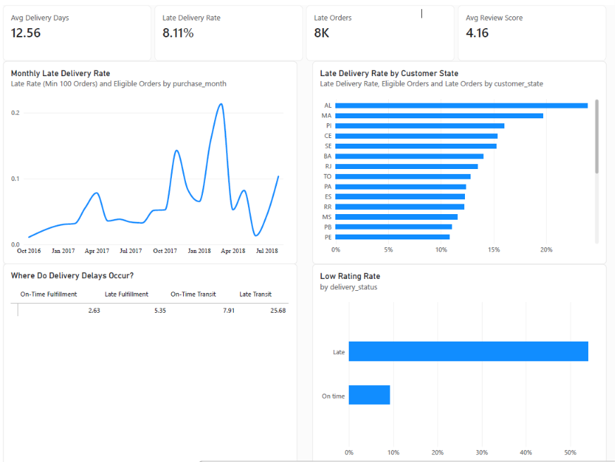

# SupplyFlow — Operations Analytics

SupplyFlow analyzes e-commerce delivery performance using the Olist dataset. It combines Python data checks, PostgreSQL analysis, and a Power BI dashboard to investigate late deliveries, logistics bottlenecks, and customer review patterns.

## Business questions

- How often do orders arrive late, and how does that change over time?
- Which customer states have the highest late delivery rates?
- Do delays occur during fulfillment or carrier transit?
- How do customer ratings differ between late and on-time deliveries?

## Dashboard



Open [SupplyFlow_Operations_Analytics.pbix](dashboard/SupplyFlow_Operations_Analytics.pbix) in Power BI Desktop to explore the report.

The saved dashboard snapshot shows:

| Metric | Displayed value |
| --- | --- |
| Average delivery time | 12.56 days |
| Late delivery rate | 8.11% |
| Late orders | Approximately 8K |
| Average review score | 4.16 |

The snapshot also shows longer average transit time for late deliveries (25.68 days) than for on-time deliveries (7.91 days). This suggests carrier transit deserves further investigation; the comparison alone does not establish the cause of delays. Values depend on the report's filters and refresh state.

## Key findings

- **8.11% of 96,470 eligible deliveries arrived late** (7,826 orders).
- **Transit deserves closer investigation:** mean transit time was 25.68 days for late orders versus 7.91 days for on-time orders in the valid-lifecycle population.
- **Geographic rate and volume tell different stories:** São Paulo and Rio de Janeiro accounted for 51.76% of late orders, while smaller states had higher late rates.
- **Low ratings were more common among reviewed late orders:** 54.07% versus 9.22% for on-time orders. This association does not establish causation.

Read the [full analysis and recommendations](docs/analysis_report.md) for evidence, population definitions, limitations and proposed operational follow-up.

## Tools and workflow

**Python** (`pandas`, `SQLAlchemy`, `psycopg2`) handles exploration, validation, and loading. **PostgreSQL** stores the source tables and analytical views. **Power BI Desktop** provides the report.

```text
Olist CSV files
    → Python exploration and validation
    → PostgreSQL raw tables
    → analytics.order_performance
    → SQL analysis and quality checks
    → analytics.dashboard_orders
    → Power BI dashboard
```

## Repository structure

```text
supplyflow/
├── dashboard/
│   ├── dashboard_overview.png
│   └── SupplyFlow_Operations_Analytics.pbix
├── data/
│   └── raw/                         # Downloaded CSV files; ignored by Git
├── docs/
│   └── analysis_report.md           # Findings and operational recommendations
├── sql/
│   ├── 01_order_performance.sql     # Order-level analytical view
│   ├── 02_data_validation.sql       # Order grain and delivery checks
│   ├── 03_delivery_kpis.sql         # Overall and monthly delivery metrics
│   ├── 04_business_analysis.sql     # State, duration, and review analysis
│   ├── 05_bottleneck_analysis.sql   # Fulfillment and transit comparison
│   ├── 06_final_validation.sql      # Lifecycle quality and exclusions
│   └── 07_dashboard_view.sql        # Power BI reporting view
├── src/
│   ├── 01_explore.py                # CSV overview and missing values
│   ├── 02_validate.py               # Uniqueness and relationship checks
│   └── load_database.py             # Rebuild schemas and load source data
└── .gitignore
```

## Run locally

### 1. Set up Python

Install Python and PostgreSQL. The commands below use PowerShell from the repository root.

```powershell
git clone https://github.com/dophat1/supplyflow.git
cd supplyflow
python -m venv .venv
.\.venv\Scripts\python.exe -m pip install pandas SQLAlchemy psycopg2-binary
```

### 2. Download the data

Download the [Brazilian E-Commerce Public Dataset by Olist](https://www.kaggle.com/datasets/olistbr/brazilian-ecommerce) and extract the CSV files into `data/raw/`.

The database loader requires these seven files:

```text
olist_orders_dataset.csv
olist_order_items_dataset.csv
olist_order_reviews_dataset.csv
olist_order_payments_dataset.csv
olist_customers_dataset.csv
olist_sellers_dataset.csv
olist_products_dataset.csv
```

Raw data is excluded from Git. Geolocation and category translation CSVs are not required by the current database loader.

### 3. Explore and validate

```powershell
.\.venv\Scripts\python.exe src/01_explore.py
.\.venv\Scripts\python.exe src/02_validate.py
```

These scripts print checks for missing values, duplicates, order status, multiple items/sellers/reviews/payments, and references between tables. Review the output before loading.

### 4. Create and load the database

Create a PostgreSQL database named `supplyflow`, using pgAdmin or:

```powershell
createdb -U postgres supplyflow
```

The loader connects to `localhost:5432` and prompts for a username (default: `postgres`) and password. The user needs permission to create and drop schemas and write tables in this database.

**The loader drops the `raw` and `analytics` schemas with `CASCADE` before rebuilding them. Run it only against your dedicated local SupplyFlow database.**

```powershell
.\.venv\Scripts\python.exe src/load_database.py
```

To use another host, port, or database name, edit the connection settings in `src/load_database.py`.

### 5. Run the SQL scripts

Run `sql/01_order_performance.sql` through `sql/07_dashboard_view.sql` in numerical order against `supplyflow`, using pgAdmin or `psql`. For example:

```powershell
psql -U postgres -d supplyflow -v ON_ERROR_STOP=1 -f sql/01_order_performance.sql
```

Repeat for scripts `02` through `07`. Scripts `01` and `07` create views; the others return analysis or validation results. Inspect the quality checks, especially duplicate orders, missing stage dates, and negative durations.

### 6. Refresh Power BI

Open the `.pbix` file in Power BI Desktop. Check its data source settings and PostgreSQL credentials for your local instance, then refresh. The reporting view is `analytics.dashboard_orders`.

## Metric definitions and data handling

| Metric or rule | Definition in the SQL |
| --- | --- |
| Analytical grain | One row per order, assuming unique source order and customer identifiers |
| Eligible delivery | Status is `delivered`, with both actual and estimated customer delivery timestamps present |
| Late delivery | Actual delivery timestamp is strictly later than the estimated timestamp |
| Late delivery rate | Late eligible orders divided by all eligible orders, multiplied by 100 |
| Delivery time | Time from purchase to customer delivery, in fractional days |
| Fulfillment time | Time from order approval to carrier handoff, in fractional days |
| Transit time | Time from carrier handoff to customer delivery, in fractional days |
| Review selection | Latest review answer timestamp per order; ties use descending review ID, with missing answer timestamps last |
| Low rating | Review score of 1 or 2; missing review scores remain null |

The bottleneck analysis includes only eligible orders with nonnegative fulfillment **and** transit durations. The dashboard view instead validates each stage independently and returns null for an invalid or missing stage duration. These populations can therefore differ.

Average review scores exclude missing scores. The dashboard view retains orders that are not delivery-eligible, so delivery measures must apply the eligibility filter. The saved monthly chart is labeled with a minimum of 100 eligible orders per month; the SQL monthly KPI query does not apply that threshold.

## Scope and limitations

This is a descriptive analysis of the supplied historical dataset. It highlights patterns and areas for investigation; it does not establish that late delivery causes lower review scores or identify a specific carrier responsible for delays. State comparisons should be read alongside order counts, and timestamp quality affects lifecycle metrics.

The repository includes executable data quality queries, but no automated test suite or pinned dependency versions. Raw data, local environments, and credentials are excluded from version control.

## Data attribution

Source data: **Brazilian E-Commerce Public Dataset by Olist**, available through the dataset link above. Refer to its source page for attribution and usage terms.
