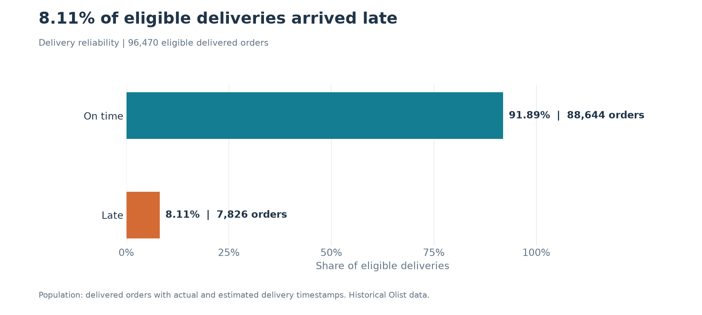
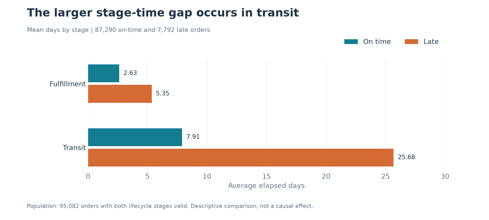
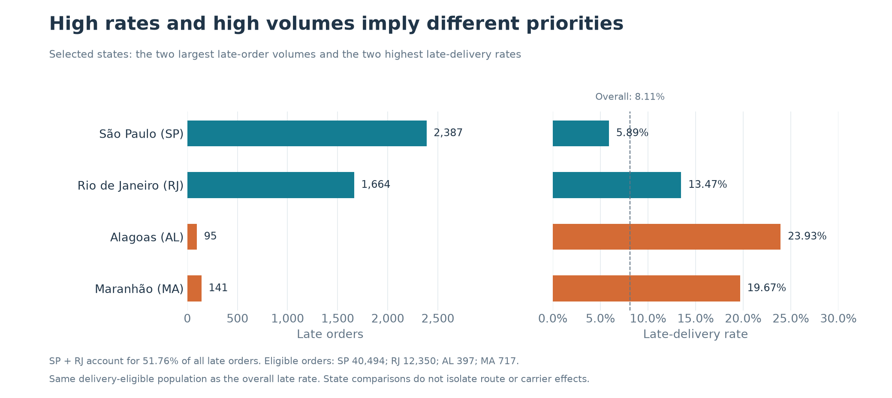
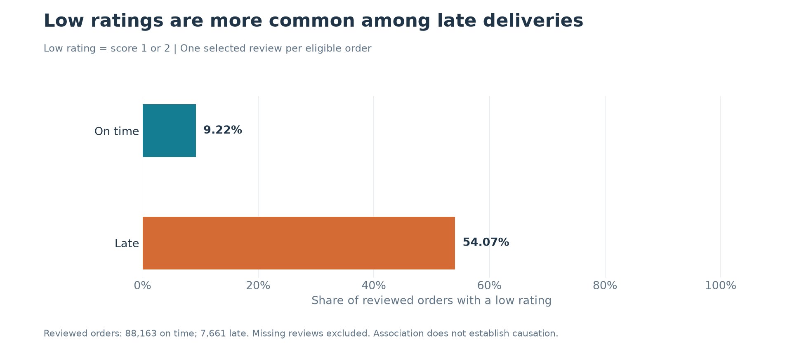

# SupplyFlow: Delivery Performance and Operational Priorities

**Decision brief | Historical Olist e-commerce data | Analysis prepared 6 November 2026**

## Executive assessment

Of **96,470 eligible delivered orders**, **7,826 arrived after their estimated delivery timestamp**, giving a late-delivery rate of **8.11%**. Average purchase-to-delivery time was **12.56 days**.

Three findings guide the recommended investigation:

- **Investigate both delivery stages, starting with transit.** Among orders with valid lifecycle timestamps, late orders had average transit times of 25.68 days, versus 7.91 days for on-time orders. Fulfillment was also longer for late orders.
- **Prioritize geography using both volume and rate.** São Paulo and Rio de Janeiro together accounted for 51.76% of late orders, while smaller states had higher late-delivery rates. These represent different operational priorities.
- **Include customer experience in the review.** Among reviewed eligible deliveries, 54.07% of late orders received a low rating, compared with 9.22% of on-time orders. This is an association, not proof that delays caused the ratings.

**Recommended decision:** commission a focused review of persistent delays in high-volume regions and high-rate smaller regions. Validate operational explanations before selecting a service intervention. The analysis supports investigation priorities; it does not identify a responsible carrier or quantify achievable savings.

<strong>Scope, population and metric definitions</strong>

The source contains 99,441 orders. Delivery-performance analysis includes the **96,470 orders** marked `delivered` with both actual and estimated delivery timestamps available. Their purchase timestamps span **15 September 2016 to 29 August 2018**. This is historical analysis, not a measurement of present-day Olist performance.

| Measure | Definition |
| --- | --- |
| Late delivery | Actual customer-delivery timestamp is strictly later than the estimated delivery timestamp |
| Late-delivery rate | Late eligible orders / all eligible delivered orders |
| Delivery time | Purchase to customer delivery, measured in fractional days |
| Fulfillment time | Order approval to carrier handoff |
| Transit time | Carrier handoff to customer delivery |
| Review used | Latest review-answer timestamp per order; ties resolved by descending review ID, with missing answer timestamps last |
| Low rating | Review score of 1 or 2; orders without a review are excluded from the rating denominator |

The analytical grain is one row per order. The source order and customer identifiers were checked for uniqueness when reproducing the results. Review records were reduced to one per order before aggregation.

## Finding 1: Approximately eight in every 100 eligible deliveries arrived late

**Evidence.** Of 96,470 eligible orders, 7,826 were late and 88,644 were on time. Mean delivery time was 12.56 days.

**Implication.** This establishes a baseline for delivery reliability. It separates overall delivery speed from the ability to meet the promise communicated to the customer: an order can take a long time and still arrive on time if its estimate allows for that duration.

**Recommended action.** Review monthly late rates together with eligible-order counts and delivery-time distributions. Establish an agreed service target before labeling a period acceptable or unacceptable. The saved dashboard's monthly chart applies a minimum of 100 eligible orders per month; the overall rate above includes all eligible orders.

**Limitation.** The source provides no business-approved service target or cost per late order. An 8.11% rate alone cannot establish an SLA breach, financial loss or an achievable improvement target. Canceled and other ineligible orders are excluded, so this is not a complete measure of order-service failures.

## Finding 2: Transit is the first stage to investigate, with fulfillment also contributing to longer delivery times

**Evidence.** The lifecycle comparison retains 95,082 eligible orders with nonnegative, nonmissing fulfillment and transit durations: 87,290 on-time orders and 7,792 late orders. The remaining 1,388 eligible orders are excluded from this comparison.

View lifecycle figures

| Delivery stage | On-time orders: mean days | Late orders: mean days | Difference, late minus on time |
| --- | ---: | ---: | ---: |
| Fulfillment | 2.63 | 5.35 | 2.72 days |
| Transit | 7.91 | 25.68 | 17.77 days |

Differences are calculated from unrounded means and displayed to two decimals.

**Implication.** The larger observed stage difference is in transit, making it a reasonable first area for investigation. Fulfillment also differs and should remain in scope. These stage averages describe where elapsed time accumulates; they do not establish the cause of lateness.

**Recommended action.** Within comparable purchase months and origin–destination regions, examine median and upper-percentile transit and fulfillment times, counts and late rates. Check whether unusually long times affect many orders or a small set of outliers. Compare promised delivery windows with actual performance before attributing the pattern solely to operational execution.

**Limitation.** Grouping orders by final lateness naturally separates orders with different delivery durations. Distance, demand, order characteristics and delivery estimates may contribute to the differences. The comparison does not isolate their effects or identify carrier responsibility.

## Finding 3: High late rates and high late-order volumes point to different geographic priorities

**Evidence.** State-level aggregation uses the same eligible-order population as the overall late rate.

View regional figures and eligible-order counts

| Customer state | Eligible orders | Late orders | Late-delivery rate |
| --- | ---: | ---: | ---: |
| São Paulo (SP) | 40,494 | 2,387 | 5.89% |
| Rio de Janeiro (RJ) | 12,350 | 1,664 | 13.47% |
| Alagoas (AL) | 397 | 95 | 23.93% |
| Maranhão (MA) | 717 | 141 | 19.67% |

São Paulo and Rio de Janeiro together account for **4,051 / 7,826 = 51.76%** of all late orders. Alagoas has the highest state late rate, but its 95 late orders represent a much smaller absolute volume.

**Implication.** A ranking by percentage alone can direct attention away from large concentrations of affected orders. A volume-only ranking can overlook regions where customers face a much higher likelihood of lateness. Rio de Janeiro merits particular attention because it combines substantial late volume with a rate above the overall baseline.

**Recommended action.** Maintain two investigation lists: high-volume sources of late orders and high-rate regions with adequate sample sizes. Start the volume review with São Paulo and Rio de Janeiro. Review Alagoas and Maranhão for persistent regional service issues, while checking monthly variation and available route characteristics.

**Limitation.** Customer state is a broad geographic grouping, not a route or carrier identifier. Aggregated rates may reflect different distances, seller locations, product mixes and seasonal patterns. These comparisons do not establish which operational intervention would work best.

## Finding 4: Late orders are associated with substantially worse customer ratings

**Evidence.** Review comparisons include only eligible orders with an available selected review: 95,824 orders in total. Missing reviews are excluded rather than treated as positive, negative or zero-rated responses.

View review counts and average scores

| Delivery status | Orders with a review | Mean review score | Low-rating rate: scores 1–2 |
| --- | ---: | ---: | ---: |
| On time | 88,163 | 4.29 | 9.22% |
| Late | 7,661 | 2.57 | 54.07% |

The low-rating rate is **44.84 percentage points higher** among reviewed late orders, calculated from unrounded rates. The overall mean review score for reviewed eligible deliveries is 4.16.

**Implication.** Delivery reliability and customer experience should be investigated together. Regions or periods with both high late-order volume and poor ratings may deserve a combined operations and customer-service review.

**Recommended action.** Inspect a sample of late orders with low scores and compare review comments, where available, with the delivery timeline. Check other possible sources of dissatisfaction, such as product or seller issues. Use that review to define a targeted service or communication pilot.

**Limitation.** The comparison is observational. Product quality, seller performance and other factors can affect ratings. Review availability also differs between groups. These results do not quantify the rating improvement, retention benefit or revenue effect that reducing delays would produce.

## What the operations manager should do next

| Priority | Action | Decision or output |
| --- | --- | --- |
| 1 | Confirm reporting filters, populations and KPI definitions before using the dashboard | An agreed baseline and service target |
| 2 | Segment São Paulo and Rio de Janeiro by month and available origin–destination information; check median and tail durations | A shortlist of persistent, high-volume delay patterns |
| 3 | Review high-rate smaller states alongside counts and delivery promises | A separate regional service-risk shortlist |
| 4 | Investigate selected late, low-rated orders with operations and customer service | Plausible explanations supported by order-level evidence |
| 5 | Select a limited intervention only after the investigation; define success metrics and a credible comparison | A pilot whose effect can be evaluated |

The immediate task is to decide **where to investigate and what additional evidence to collect**. Operational changes, financial benefits and causal conclusions require further evidence.

<strong>Reproducibility and interpretation notes</strong>

- Figures were recomputed from the local source CSVs using the eligibility, review-selection and lifecycle rules in the SQL. The existing database and Power BI workbook were not refreshed for this report.
- The report's lifecycle comparison requires both stages to be valid, matching the bottleneck-analysis SQL. The dashboard reporting view validates each stage independently. Stage means can therefore differ when populations or filters differ.
- The SQL lateness rule compares full timestamps. An estimated date stored at midnight is treated as that timestamp; the analysis does not independently establish the business's intended end-of-day promise convention.
- Averages can conceal outliers. The recommended follow-up should include distributions and segment counts.
- No causal effects, intervention outcomes or financial savings are estimated.

## Supporting material

- [Dashboard preview](../dashboard/dashboard_overview.png)
- [Power BI workbook](../dashboard/SupplyFlow_Operations_Analytics.pbix)
- [Order-level definitions and review selection](../sql/01_order_performance.sql)
- [Overall and monthly KPIs](../sql/03_delivery_kpis.sql)
- [State and delivery-time analysis](../sql/04_business_analysis.sql)
- [Fulfillment and transit comparison](../sql/05_bottleneck_analysis.sql)
- [Lifecycle quality checks](../sql/06_final_validation.sql)
- [Dashboard reporting view](../sql/07_dashboard_view.sql)
- [Project setup and methodology](../README.md)

Source: Brazilian E-Commerce Public Dataset by Olist; attribution and dataset link are provided in the project README.
